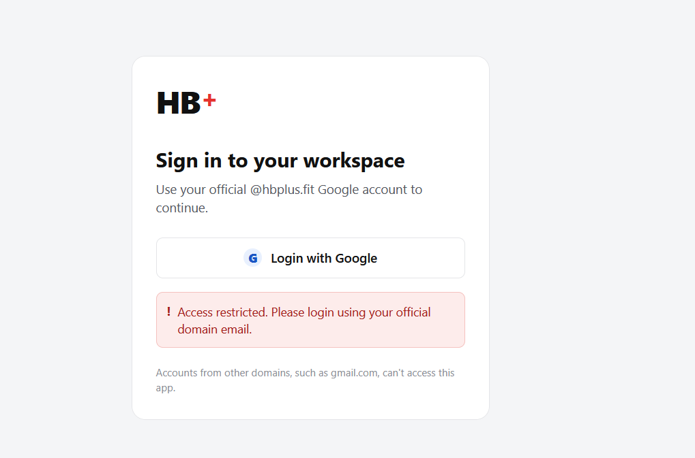
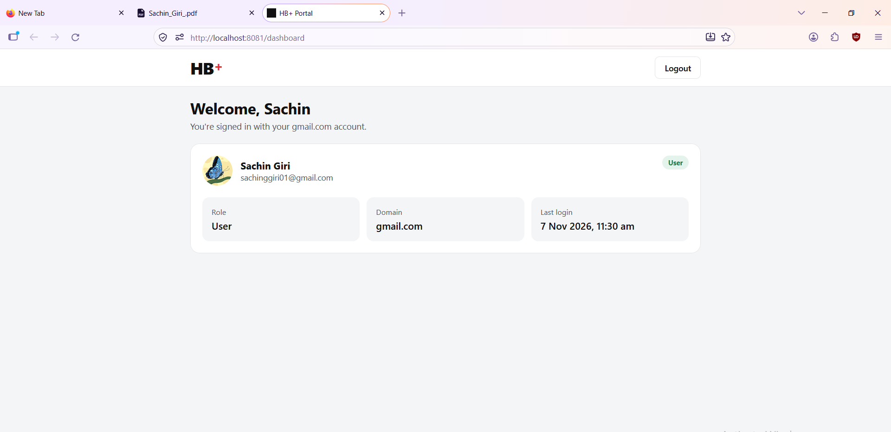
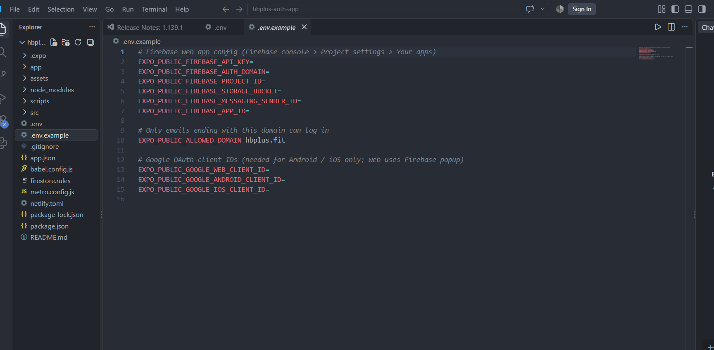
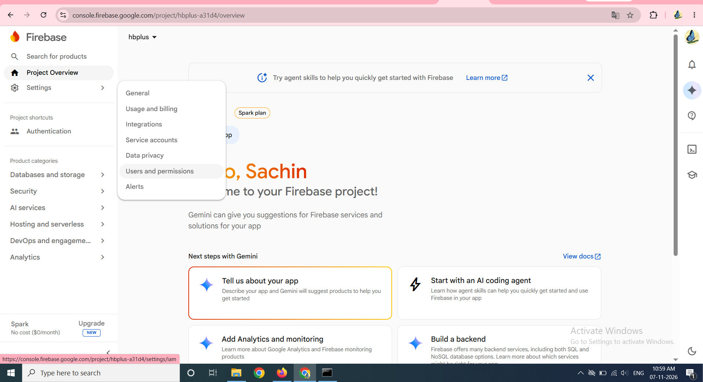
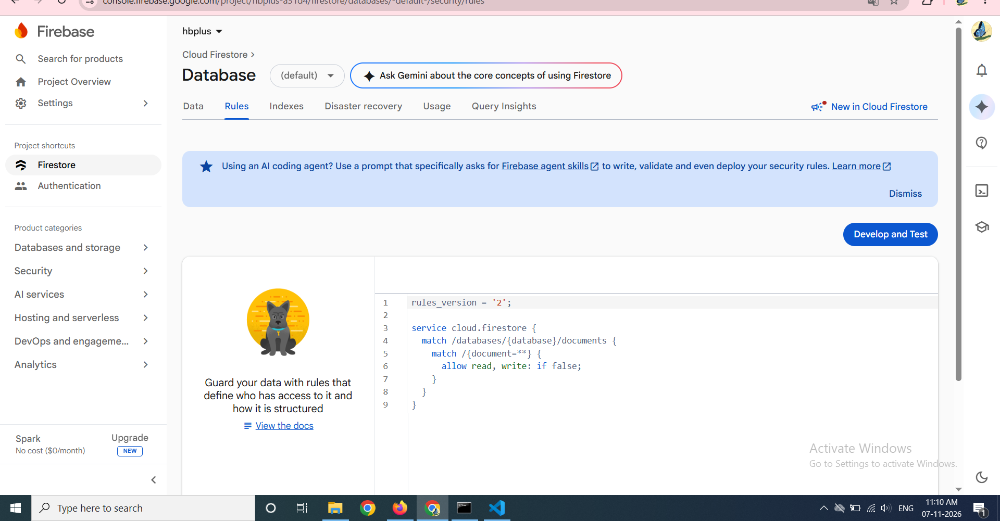
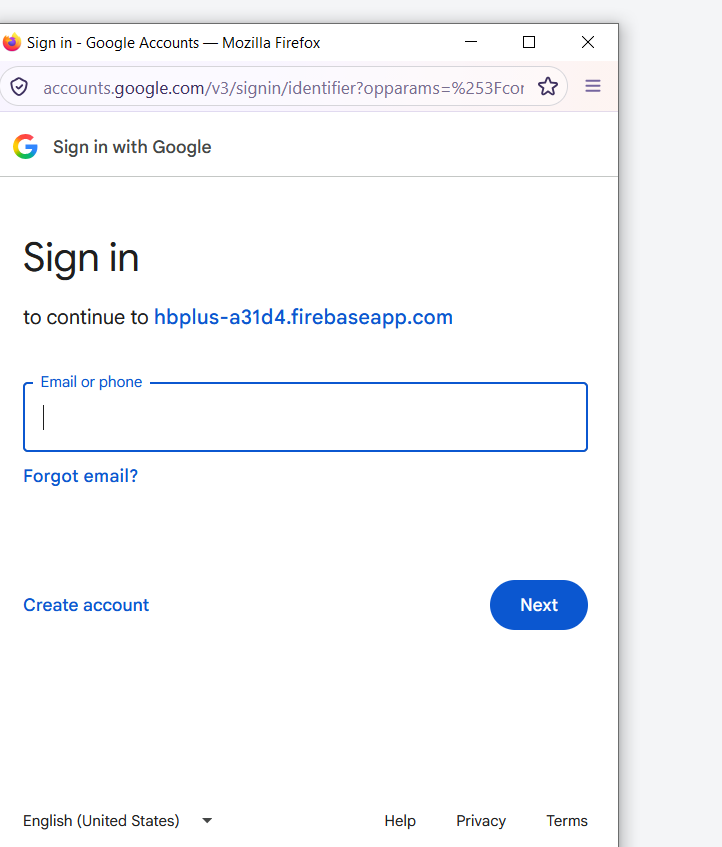

# HB+ Portal: Google login with domain restriction

One React Native codebase (Expo + React Native for Web) that runs on **Android, iOS and the browser**.
Users sign in with Google. Only emails ending in **@hbplus.fit** get in. Everyone else sees:

> Access restricted. Please login using your official domain email.

**Live demo:** `<add your Netlify link here>`

## Screenshots

| Login with a non-company email (blocked) | Dashboard after a successful login |
|---|---|
|  |  |

> The dashboard screenshot was taken during local testing with the allowed domain temporarily set to `gmail.com`
> (the tester had no `@hbplus.fit` account). The submitted configuration allows only `hbplus.fit`.

## Features
- Google Sign-In (OAuth 2.0 through Firebase Authentication)
- Domain validation (`@hbplus.fit`, configurable from `.env`)
- Protected Dashboard (no access by direct URL without login)
- Logout, loading states, friendly error handling
- Bonus: roles (Admin / User), user data stored in Firestore, admin-only user list
- Responsive, clean UI

## Tech stack
React Native (Expo SDK 52) · React Native for Web · expo-router · Firebase Auth + Firestore · Netlify

## Folder structure
```
app/                   Routes (expo-router)
  _layout.js           Auth provider + route guard
  login.js             Login page
  dashboard.js         Protected dashboard (admin panel for admins)
  index.js, +not-found.js
src/
  components/          GoogleButton, ErrorBanner, Loader, Badge, Logo
  context/AuthContext  Auth state + domain validation
  hooks/               useGoogleAuth.js (web) / useGoogleAuth.native.js (mobile)
  services/            firebase.js (web), firebase.native.js, userService.js
  utils/               validateDomain.js, errors.js, format.js
  theme/ config.js
docs/screenshots/      Images used in this README
firestore.rules        Server-side security rules
netlify.toml           Build + SPA redirect config
```

## Setup (step by step)

### Step 1. Install the project
```bash
npm install
copy .env.example .env      # macOS/Linux: cp .env.example .env
```
This creates two files. `.env.example` is the empty template (safe to commit). `.env` holds your real keys and is ignored by Git.



### Step 2. Create the Firebase project
1. Open https://console.firebase.google.com and click **Create a new Firebase project**. Google Analytics is not needed.
2. **Build > Authentication > Get started > Sign-in method > Google > Enable.** Choose a support email and save.
3. Open **Project settings** from the gear/Settings menu on the left, then **General**.



4. Scroll to **Your apps**, click the **Web (`</>`)** icon, register the app, and copy the `firebaseConfig` values.

### Step 3. Fill in `.env`
```dotenv
EXPO_PUBLIC_FIREBASE_API_KEY=...
EXPO_PUBLIC_FIREBASE_AUTH_DOMAIN=...
EXPO_PUBLIC_FIREBASE_PROJECT_ID=...
EXPO_PUBLIC_FIREBASE_STORAGE_BUCKET=...
EXPO_PUBLIC_FIREBASE_MESSAGING_SENDER_ID=...
EXPO_PUBLIC_FIREBASE_APP_ID=...
EXPO_PUBLIC_ALLOWED_DOMAIN=hbplus.fit
```
No quotes, no spaces around `=`. Restart `npm run web` after any change to `.env`.

### Step 4. Create Firestore and publish the security rules
1. **Build > Firestore Database > Create database** (Standard edition, location `asia-south1`, production mode). Leave scheduled backups off (needs a paid plan).
2. Open the **Rules** tab, replace everything with the content of `firestore.rules`, and click **Publish**.



### Step 5. Run the app
```bash
npm run web        # browser at http://localhost:8081
npm run android    # Android emulator
npm run ios        # iOS simulator (macOS only)
```
Click **Login with Google**. The Google account chooser opens in a popup.



- A non-company account (for example `@gmail.com`) is signed out immediately and sees the "Access restricted" message (first screenshot above).
- A `@hbplus.fit` account lands on the Dashboard (second screenshot above).

### Step 6. Make someone an admin (optional)
New users get role `user`. In Firestore open `users` > the user's document and change `role` to `admin`.
Users cannot change their own role: the Firestore rules block it. Admins see an extra "All users" list on the dashboard.

### Step 7. Android and iOS (optional)
The web version needs only the Firebase keys. For mobile, create OAuth client IDs in Google Cloud Console
(APIs & Services > Credentials) and set `EXPO_PUBLIC_GOOGLE_WEB_CLIENT_ID` (the Web client Firebase created),
`EXPO_PUBLIC_GOOGLE_ANDROID_CLIENT_ID` and `EXPO_PUBLIC_GOOGLE_IOS_CLIENT_ID`.
Google sign-in on native needs a development build (`npx expo run:android`), not Expo Go.

### Step 8. Deploy to Netlify
1. Push this repository to GitHub.
2. Netlify > Add new site > Import from Git. Build settings are read from `netlify.toml`
   (`npm run build:web`, publish folder `dist`).
3. Site settings > Environment variables: add every variable from `.env`.
4. Deploy, then add the Netlify domain to Firebase > Authentication > Settings > **Authorised domains**.

## Authentication flow
1. User taps **Login with Google**. The button shows a loading state.
2. Web: Firebase popup (`signInWithPopup`, with a redirect fallback). Mobile: Google OAuth 2.0 via `expo-auth-session`; the Google ID token is exchanged with Firebase (`signInWithCredential`).
3. Firebase reports the signed-in user to `AuthContext` (`onAuthStateChanged`). This is the **one place every login is validated**, including a session restored after a page refresh.
4. `AuthContext` checks the email domain.
   - Allowed: the user profile is created or updated in Firestore, and the user goes to `/dashboard`.
   - Not allowed: the user is signed out immediately, nothing is written to the database, and the error message is shown.
5. The route guard in `app/_layout.js` redirects: no user on a private route goes to `/login`; a logged-in user on `/login` goes to `/dashboard`.

## How domain restriction works (2 layers)
1. **Client validation:** `isAllowedEmail()` in `src/utils/validateDomain.js` compares the text after the last `@` with the allowed domain (case-insensitive) and requires a verified email. It rejects tricks like `hbplus.fit@gmail.com` or `a@hbplus.fit.evil.com`. Run `npm test` to see the test cases.
2. **Server validation:** `firestore.rules` checks that `request.auth.token.email` ends with `@hbplus.fit` and that `email_verified == true`. A modified client from another domain cannot read or write any data.

The Google account chooser is intentionally not pre-filtered, so people with other accounts can try to log in and receive the clear error message.

## Security notes
- **Token handling:** tokens are managed by the Firebase SDK. They are never stored manually, logged, or put in URLs. Sessions persist in IndexedDB (web) or AsyncStorage (mobile), and ID tokens refresh automatically. Use `user.getIdToken()` when calling your own API.
- **Protected routes:** the guard runs on every route, and the dashboard also refuses to render without a verified user.
- **Roles:** stored in Firestore and protected by rules (users cannot give themselves admin).
- Firebase web keys are public identifiers by design; security comes from the rules above.
- Limitation: Firebase Auth accepts any Google account at the provider level; a wrong-domain user is signed out by the app and blocked from data by the rules. For a hard block at sign-in, use Firebase Blocking Functions (Identity Platform).

## Scripts
`npm run web` · `npm run android` · `npm run ios` · `npm run build:web` · `npm test`
